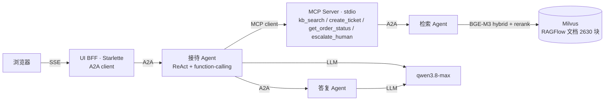

# A2A 智能客服 · Function Call + MCP + Agent + A2A 四层实践

一个可运行、可展示的**大模型应用作品集项目**：用官方 **A2A 协议**编排三个 Agent 做客服问答，
知识库为 **RAGFlow 官方中文文档**（RAG），并把 **MCP 工具 + LLM function-calling** 接进接待 Agent，
凑齐 **Function Call → MCP → Agent → A2A** 四层一体。

> 一句话：用户提问 → 接待 Agent 用 function-calling 自主选工具（工具经 MCP 提供）→
> 其中一个工具 `kb_search` 桥接到检索 Agent（A2A）走 Milvus RAG → 收敛后调答复 Agent 生成 grounded 答复。

---

## 亮点：四层各司其职

| 层 | 在本项目里是什么 | 代码 |
|---|---|---|
| **Function Call** | 接待用 qwen 的 `tools`/`tool_calls` 决定调用哪个工具 | `common/llm_client.py:chat_tools` |
| **MCP** | 独立 stdio 进程提供工具（`kb_search`/`create_ticket`/…），接待作 MCP client | `mcp_server/`、`agents/reception/mcp_client.py` |
| **Agent** | 接待是多轮 ReAct agent（自主选工具、步数上限、结果回填） | `agents/reception/react.py`、`service.py` |
| **A2A** | 三 Agent 间 + UI↔接待 全走官方 a2a-sdk（JSON-RPC + Agent Card） | `agents/{reception,retrieval,reply}`、`common/a2a_app.py` |



## 架构：三个 Agent

- **接待 Reception（唯一对外入口 + 唯一有状态者）**：分流判定（是否客服）→ ReAct 工具循环 →
  编排下游 → 会话按 `context_id` 维持 → 统一兜底。端口 `8001`。
- **检索 Retrieval（纯 A2A server）**：BGE-M3 hybrid 召回（dense1024+sparse，`WeightedRanker(1.0,0.7)`，k=8）
  → 去重取父块 → `bge-reranker-large` 精排取 n=2。端口 `8002`。
- **答复 Reply（纯 A2A server）**：依据 `{query, chunks, history}` 生成中文 grounded 答复。端口 `8003`。
- **UI（Starlette BFF + A2A client）**：把接待的 A2A 流翻译成浏览器 SSE（`token/status/trace/done`），
  前端 `fetch`+`ReadableStream` 渲染对话 + 可展开的**协作过程 trace**（含工具调用）。端口 `8080`。

## 技术栈

- 协议/框架：**a2a-sdk 1.2.2**、**mcp 2.3.0**、Starlette（BFF；不用 FastAPI 以兼容 a2a 锁定的 starlette 1.7）
- RAG：**Milvus 2.6**（`pymilvus`）+ **BGE-M3**（dense+sparse hybrid）+ **bge-reranker-large**（CPU 推理，`sentence-transformers`/`milvus-model`）
- 模型：**分层用模**（DashScope OpenAI 兼容，按 Agent 配置 `llm` 段覆盖）——分流 + ReAct 路由走快的 `deepseek-v4-flash-0731`（支持 function-calling），最终答复走强模型 `qwen3.8-max`
- 分层父子切分：父 1200 / 子 300 / 重叠 50（`langchain-text-splitters` 的 `MarkdownTextSplitter`）
- 测试：**pytest + pytest-asyncio**，进程内 `httpx ASGITransport` 免端口驱动 A2A

## 目录结构

```
src/
  agents/{reception,retrieval,reply}/   # 三个 A2A Agent（executor + app + __main__）
  common/       # 配置/日志/A2A 装配工厂/LLM 客户端/提示词一致性校验
  mcp_server/   # 独立 MCP 工具服务器（stdio）
  ui/           # Starlette BFF + 前端页
  ingest/       # RAGFlow 语料：抓取→归档HTML→分层切分→BGE-M3→Milvus
config/         # 全部参数走 YAML（common/agents/*/ingest/mcp/ui），不硬编码
tests/          # unit + integration（含 -m e2e / -m llm 外部测）
docs/           # prompts 记录 + records 运行/质量记录 + agents 规范
```

## 快速开始（本地）

依赖：Python 3.10、一台跑着 **Milvus** 的机器（本项目用 VM `192.168.88.101:19530`）、
环境变量 `aliyun_API_KEY`（DashScope Key）。

1. 建库并灌语料（一次性）：
   ```bash
   PYTHONPATH=src python -m ingest run --crawl-only   # 抓 /docs → 归档 HTML+Markdown
   PYTHONPATH=src python -m ingest run --reuse         # 切分 → BGE-M3 → upsert Milvus
   ```
2. 起 4 个服务 —— **一键**（推荐）：PyCharm 里右键 Run `src/main.py`，或命令行
   ```bash
   PYTHONPATH=src python -m main     # 同时拉起 检索/答复/接待/UI，Ctrl+C 一并停止
   ```
   它会自动给子进程注入 `A2A_LOCAL=1`、`PYTHONPATH=src`。想分开终端各自看日志，也可手动逐个起：
   ```bash
   python -m agents.retrieval   # :8002（首次加载 BGE-M3，稍等）
   python -m agents.reply       # :8003
   python -m agents.reception   # :8001（会自动拉起 MCP server 子进程）
   python -m ui                 # :8080
   ```
3. 浏览器打开 `http://127.0.0.1:8080`，提问，例如
   `我要退货，订单 ORD123 到哪了` —— 看流式答复 + 展开「协作过程」看工具调用。

> `A2A_LOCAL=1` 会把配置里的容器 service-name（`http://retrieval:8002` 等）自动改写成 `127.0.0.1`，
> 本地与容器共用同一份配置。

## 测试

```bash
python -m pytest              # 默认只跑无外部依赖的快测：51 passed, 4 deselected
python -m pytest -m e2e       # 真检索/真 LLM 全链路（需服务在跑）
python -m pytest -m llm       # 真实大模型出文（需 aliyun_API_KEY）
```

外部依赖测试用 marker 隔离，默认不跑，避免误打真模型/VM。

## 效果与实测数据

- **检索质量**：`recall@2 = 0.81`（16 条 golden set，达标 ≥0.8）。调优与已知难例见
  [`docs/records/retrieval-quality.md`](docs/records/retrieval-quality.md)。
- **性能冒烟**（演示级样本，CPU）：见 [`docs/records/perf-smoke.md`](docs/records/perf-smoke.md)。
  端到端均值 ~83s、检索 P95 ~7.9s，**超出预设软目标**——主因是 ReAct 会多次调用 `kb_search` +
  CPU 上 BGE-M3/rerank 偏慢。已如实记录并给出优化方向（约束检索次数、流式生成、模型 warm-up/复用）。
- **性能优化（第一档，已落地）**：针对上面主因做了三件事——① 答复**逐 token 流式生成**
  （`LLMClient.chat_stream` + `ReplyAgent.generate_stream` + 增量 artifact，接待以 `streaming=True`
  透传，前端逐字显示，消除「干等后整屏刷出」）；② 接待发**每轮中间状态事件**（分流 / 调用工具 X /
  生成答复，状态胶囊随阶段变）；③ **检索结果 LRU 缓存** + ReAct 提示词约束「每子问题只检索一次」，
  砍掉重复的 CPU BGE-M3/rerank。离线测试已覆盖（`pytest` 68 passed）；上面的延迟数字待起全栈
  + VM Milvus 后复测更新（未臆造新数字）。详见 `docs/records/{reply,reception,retrieval}.md`。
- **性能优化（第二档 · 提速，已落地）**：实测一次问答 ~124s 里约 107s 是模型延迟，故按「路由用快、答复用强」分层——① 分流 + ReAct 路由换 `deepseek-v4-flash-0731`（配置驱动，已验证支持 function-calling），最终答复仍用 `qwen3.8-max`；② 分流**快速失败**（20s 超时、不重试），消除偶发的 ~240s 分类卡顿（失败仍保守放行）；③ 答复 `max_tokens=600` + 简洁提示词，缩短生成。全部走 `config/agents/*.yaml` 的 `llm` 段 + `common.config.llm_for`，离线 `tests/unit/test_llm_config_roles.py` 覆盖；端到端延迟改善幅度待起全栈复测，未臆造新数字。
- **性能优化（第三档 · 重复问题秒回，已落地）**：加**答案级缓存**（`agents/reception/answer_cache.py`）——按**归一化问题文本**（转小写 + 去空白/标点）为 key、TTL 一天，重复/换着问法问同一问题直接命中、**跳过 triage→ReAct→检索→生成整条链路**；**每轮都查**缓存（所以同一会话里重复问也能秒命中），但**只写**无上下文的独立提问（带指代的追问不入库、字面也不同故不会误命中）；配置 `reception.yaml: answer_cache`，UI trace 显示「命中缓存」。注：一次复合问题里调 2 次 `kb_search` 是**有意拆解**（文件格式 + 模型支持各查各的），不是浪费。离线 `tests/unit/test_answer_cache.py` + service 缓存命中测覆盖。

## 设计要点

- **配置驱动、不硬编码**：端口 / Card / 提示词 / 检索参数 / 步数上限全在 `config/*.yaml`；密钥只从环境变量读。
- **可复现的提示词记录**：`docs/prompts/` 记当前版 + `docs/records/` 记变更历史，
  并有 **pytest 一致性校验**——改了 `config` 没同步记录就测试红（`python -m common.prompt_check`）。
- **降级兜底**：非客服 / 下游失败 / 检索空，都统一兜底且任务 `COMPLETED`，技术细节只进日志。
- **可测试性**：A2A 用 `httpx ASGITransport` 进程内驱动、LLM/MCP/会话都可注入 fake，核心逻辑离线可测。
- **日志规范**：统一「模块:类.函数:行号」，便于定位与测试断言。

## 语料与许可

知识库语料来自 **RAGFlow 官方中文文档**（Apache-2.0），抓取归档在 `data/ragflow_docs/`
（`.gitignore` 内，不入库 git）。本项目为学习/作品集用途。

## 已知局限

- 端到端**绝对**延迟仍受 CPU 上 BGE-M3/rerank 限制；第一档优化（流式生成 + 每轮状态 + 检索缓存）
  主要改善**感知延迟**与**重复检索**，未做生产级并发/弹性（超出作品集范围）。
- 检索对语义近邻文档（如 Confluence↔Notion）偶有混淆，见质量记录。
- 会话默认内存存储；Redis 后端已实现，留部署阶段启用。
